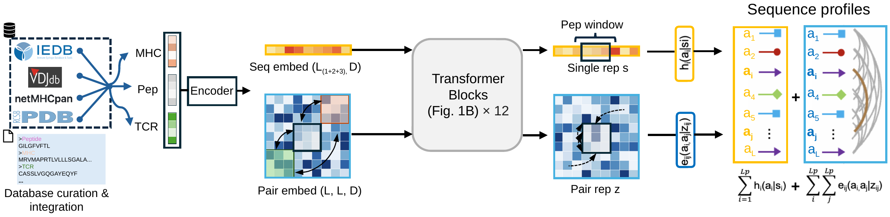

# GRIP

**Energy-guided de novo design of functional immunogenic neoantigens**

GRIP learns how peptide sequences interact with MHCs and T-cell receptors to guide immunopeptide design. This repository contains the core model and sequence-scoring code.

[](docs/assets/figure-1.pdf)

## Installation

Requires Python 3.9+ and PyTorch 2.6+.

```bash
git clone https://github.com/cosmoss8274/GRIP.git
cd GRIP
python -m pip install .
```

## Usage

Trained weights are not included in this repository. With a compatible checkpoint, use its configuration and SHA-256 digest:

```python
from grip_models import BaseEnergyModel, load_config, load_weights, score_record

config = load_config("config.json")
model = BaseEnergyModel(config)
load_weights(model, "model.pt", sha256=checkpoint_sha256)
model.eval()

energies = score_record(model, record, config)
```

`record` contains a peptide sequence and its MHC or TCR context. The output contains single-residue, pairwise and total energies. See [usage notes](docs/usage.md) for input fields, checkpoint formats and test commands.

## License

[MIT](LICENSE).
