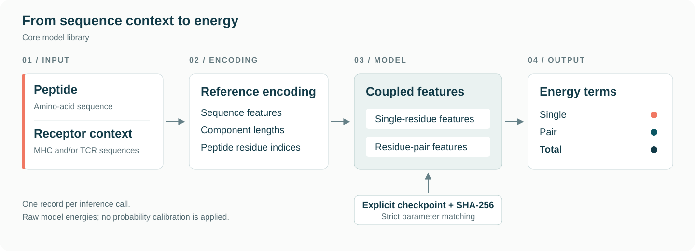

# GRIP

**A conditional energy model for peptide–receptor interactions.**

GRIP represents peptide sequences together with MHC and TCR sequence context and returns single, pair and total energy terms. This development release (`0.1.0.dev0`) provides the reference model core, its original data encoding, and explicit configuration, checkpoint-loading and scoring interfaces.



## Install

The package requires Python 3.9 or later and PyTorch 2.6 or later. From a checkout, install into a dedicated environment:

```sh
python -m pip install .
```

For the tested CPU development environment, use Python 3.12 and the versions in `requirements-test.txt`:

```sh
python -m pip install -r requirements-test.txt
python -m pip install --no-deps .
```

These versions describe the development tests; they do not reconstruct a historical training environment.

## Load a model explicitly

Use the configuration associated with the checkpoint and its expected SHA-256 digest. The following helper uses the public API and leaves all artifact selection to the caller:

```python
from grip_models import BaseEnergyModel, load_config, load_weights, score_record


def restore_model(*, config_path, checkpoint_path, expected_sha256,
                  state_dict_key=None):
    config = load_config(config_path)
    model = BaseEnergyModel(config)
    receipt = load_weights(
        model,
        checkpoint_path,
        sha256=expected_sha256,
        state_dict_key=state_dict_key,
    )
    model.eval()
    return model, config, receipt
```

`state_dict_key=None` selects a checkpoint that is itself a state dictionary. For a wrapped checkpoint, supply its exact top-level key. Loading verifies the whole file, uses PyTorch's weights-only deserializer on CPU, and checks every key, tensor shape and dtype before a strict state load. It does not search for checkpoints, remove key prefixes or add missing heads.

After restoring a compatible model, call `score_record(model, record, config)`. A record contains `epitope_sequence` and at least one nonempty context field: `mhc`, `l_v`, `l_j`, `h_v`, `cdr3_b` or `h_j`. Values are canonical uppercase amino-acid sequences. The adapter rejects unsupported input rather than rewriting sequences. Results are the model's `single`, `pair` and `total` energies; no binding-probability calibration is applied.

## Package scope

| Location | Contents |
| --- | --- |
| `src/grip_models/` | Model core, original training encoder and public inference interfaces |
| `tests/` | Source-preservation and interface tests |
| `docs/` | Technical and reproducibility documentation |

The installed package excludes web applications, sampling, physical refinement, training data and checkpoint files. Importing `grip_models` alone does not load model dependencies or weights.

## Verification and release status

Three CPU comparisons between the original and packaged core, using synthetic inputs and identical model state, produced a maximum absolute difference of **0.0** in every case. This establishes agreement for those source-relocation tests; it does not verify trained-model predictions or benchmark performance.

This development release does not bundle trained checkpoints or a validated ensemble configuration. See [Reproducibility](docs/reproducibility.md) for the configuration and weight contract, test commands and the evidence needed to reproduce a trained result.

## License

The repository retains its [MIT license](LICENSE), Copyright (c) 2025 YCHAI. Third-party components remain subject to their applicable licenses.
