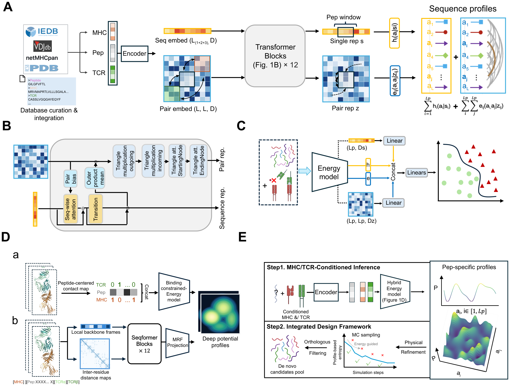

# Energy-guided de novo design of functional immunogenic neoantigens

GRIP is an energy-guided framework for designing immunopeptides for specified MHC and T-cell receptor contexts. It learns single-residue preferences and pairwise residue couplings to connect binding prediction with peptide sequence design. The study combines computational benchmarks with experimental validation of MHC-I and MHC-II binding. In the KRAS G12D system, designed peptides elicited T-cell-mediated cytotoxicity comparable to or greater than that of the native peptide in the tested TCR clonotypes.

This repository provides source code for the sequence energy model, GRIP-CLA classifier and inverse model for structure-conditioned peptide design.

[](docs/assets/figure-1.pdf)

[Website](https://zhanggroup.org/GRIP/) · [Usage](docs/usage.md) · [Model interfaces](docs/models.md)

## Installation

Requires Python 3.9+ and PyTorch 2.6+.

```bash
git clone https://github.com/cosmoss8274/GRIP.git
cd GRIP
python -m pip install .
```

## Run model

Score a sequence record with a local checkpoint and its matching configuration:

```bash
python examples/core.py score --record record.json --checkpoint model.pt --config config.json
```

The model returns single-site, pairwise and total energies. Supply the peptide and receptor context in [the input format](docs/usage.md#prepare-a-record), using the sequence representation supported by the checkpoint.

To try input encoding, run `python examples/core.py encode`. See [Usage](docs/usage.md) for Python examples and [Models](docs/models.md) for classification and inverse inference.

## License

[MIT](LICENSE). External dependencies retain their respective terms; see [Dependencies](docs/dependencies.md).
